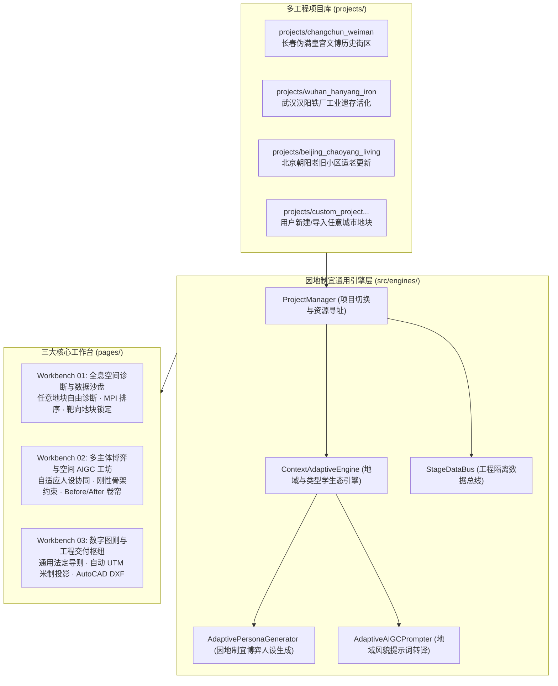

# 多工程项目库隔离与因地制宜空间更新推演平台架构设计方案 (RFC / Design Spec)

## 一、背景与设计目标

### 1.1 核心痛点与定位转变
- **原平台局限**：前期开发中业务逻辑与示例数据（长春市宽城区伪满皇宫周边、长春水产大市场、伊通河滨水区）耦合较深，缺乏跨城市、跨更新类型和跨地块的快速适配能力。
- **全新定位**：打造**“适用于所有地块、因地制宜”的通用城乡更新空间设计智能推演平台**。
- **用户选定架构**：**方案 C（多工程项目库隔离模式）**。平台支持多城市、多类型“城市更新项目工程”的独立隔离管理，通过一键项目切换器载入对应的数据集（GIS底模、POI、街景、地方政策法规）与推演规则底座；同时在单个工程内支持对任意候选地块进行量化诊断、多主体博弈决策、刚性 AIGC 风貌生形与工业级 CAD 矢量图则交付。

---

## 二、总体架构与分层设计

平台采用**“工程配置隔离层 + 因地制宜适配引擎层 + 三大工作台业务呈现层”**的三层解耦架构：



---

## 三、核心模块详细设计

### 3.1 项目工程结构标准 (`projects/{project_id}/`)
每个独立的项目工程具备标准化目录结构：
```
projects/{project_id}/
├── project.yaml            # 工程主配置文件（城市、行政区、更新类型、地域风貌、控规指标底线、视口中心）
├── policies.json           # 本地法定规划法规与历史名城保护条例知识库
├── gis/                    # 工程专属空间底模（若缺失自动回退通用合成/OSM拉取）
│   ├── Boundary_Scope.geojson        # 规划红线
│   ├── Key_Plots_District.json       # 待评估候选地块集
│   ├── Building_Footprints.geojson   # 建筑现状底模
│   └── road_clipped.geojson          # 道路骨架
└── context/                # 该工程历史阶段生成成果持久化快照
```

### 3.2 典型预置工程模板（覆盖全国主流更新类型与气候区）

| 工程标识 (`project_id`) | 城市与区位 | 更新类型学 | 地域风貌与气候约束 | 核心矛盾与规划底线 |
| :--- | :--- | :--- | :--- | :--- |
| **`changchun_weiman`** (默认示范) | 吉林长春·宽城区 | 🏛️ 历史文脉街区更新 | 北方严寒气候 · 红砖暖灰基调 · 坡屋顶防雪 · 避风向阳 | 皇宫视廊管控、限高9-18m、容积率≤1.4、保留大跨度工业桁架 |
| **`wuhan_hanyang_iron`** (工业遗存) | 湖北武汉·汉阳区 | 🏭 工业棕地与遗存活化 | 华中湿热气候 · 耐候锈红钢板 · 大跨度桁架 · 滨江漫步道 | 工业遗存保留率≥80%、生态排污修复、文创孵化、滨江视廊 |
| **`beijing_chaoyang_living`** (老旧小区) | 北京市·朝阳区 | 🏘️ 老旧小区微更新 | 北方干冷气候 · 现代暖灰青砖 · 适老化口袋公园 · 慢行林荫 | 既有建筑外挂电梯、日照间距达标、消防通道打通、停车治理 |

---

### 3.3 因地制宜适配引擎 (`ContextAdaptiveEngine`)

#### (1) 地块多维痛点自动推断 (`infer_plot_diagnostics`)
当用户在任何工程中切换或选中某个地块时，引擎基于地块的定量特征（MPI得分、面积、现状用地性质、绿视率 GVI、POI 密度、天空开敞度 SVF）自动推导出因地制宜的**现状核心痛点清单**，彻底杜绝硬编码：
- **用地类型为工业/仓储** → 自动推断：“原产业物流功能外迁导致厂房闲置、大跨度工业结构待活化利用、工业风貌与城市界面割裂”。
- **用地类型为老旧居住** → 自动推断：“公共服务与适老设施匮乏、微循环管网老化、人车混行严重、缺乏开敞绿色活动空间”。
- **用地类型为低效商业/集贸** → 自动推断：“沿街占道经营混乱、空间环境品质衰退、停车与物流装卸严重阻碍交通”。
- **GVI 极低 (< 0.15)** → 自动注入：“绿视率严重不足，需见缝插针织补口袋公园与生态微绿廊”。

#### (2) 因地制宜多主体博弈人设生成器 (`generate_adaptive_personas`)
Stage 07 中的居民代表（老王）、投资运营方（赵总）、规划把关人（李工）三方 System Prompts 全部改为**动态实时组装**：
- **居民代表**：根据工程城市气候（北方注重冬日向阳避风、南方注重遮阳通风）与地块类型（居住关注民生适老、工业关注环境健康、商业关注便民菜市）提出切身诉求；
- **投资运营方**：根据地块性质提出相符的商业业态模型（工业提创客孵化/艺术展览，居住提社区底商/托幼养老，历史街区提文旅消费/沉浸体验），在法定容积率允许区间争取合理投资回报；
- **规划师**：严格守住当前工程配置中的地方规划法规（如限高、绿地率底线、风貌红线），作为平衡各方利益的专业仲裁人。

#### (3) 因地制宜 AIGC 提示词转译器 (`generate_adaptive_prompts`)
根据当前工程的【地域风貌预设】（如北方红砖暖灰、江南粉墙黛瓦、岭南特色骑楼、现代低碳木构）与【博弈共识关键词】，为 ControlNet 和 Stable Diffusion 动态生成具备地域特色与风貌管控的提示词组，**让生成式 AI 在任何城市任何地块都能画出符合当地风貌的高水准方案**。

---

### 3.4 交互动线与界面呈现升级

1. **全局顶部项目工程切换器**：
   - 在 [`app.py`](file:///e:/AI-based-project/urban-platform/app.py) 顶栏与三大工作台公共区域增设醒目的 **“🏛️ 规划工程中枢”** 胶囊切换器：
     支持一键在【长春伪满皇宫街区】、【武汉汉阳铁厂工业遗存】、【北京朝阳老旧小区】之间无缝切换，同时提供【➕ 接入新地块工程】向导。
   - 切换工程时，`StageDataBus` 自动重置并加载目标工程的 GIS 与上下文，全站视图实时刷新。
2. **工作台 1：任意地块自由诊断与靶向锁定**：
   - 在 MPI 潜力评估和地块雷达中，提供所有候选地块下拉框与单选高亮；
   - 用户点击 **“🎯 设为当前更新靶向地块”** 即可锁定该地块，系统实时展示其因地制宜诊断画像并自动同步至下游。
3. **工作台 2：因地制宜博弈面板**：
   - 增加“因地制宜参数看板”（展示当前城市、更新类型、控规限高、地块痛点）；
   - 三主体围绕当前锁定地块展开自适应推演，自动合成符合当地特征的结构化设计纲要。
4. **工作台 3：自适应法定图则与 CAD 导出**：
   - 根据当前工程地理经纬度自动计算最佳 UTM 投影代号（如经度 125° -> UTM 51N，经度 114° -> UTM 50N，经度 116° -> UTM 50N），确保全国任何城市的矢量 CAD 导出均为 1:1 米制工程图纸，图层规范统一遵循国家 GB/T 标准。

---

## 四、实施计划

- **第一阶段：多工程目录与项目管理中枢实现**
  - 创建 `projects/` 规范目录，迁移内置 3 大标杆工程（长春、武汉、北京）；
  - 实现 `src/workflow/project_manager.py`，提供项目发现、切换、读写与动态数据寻址接口。
- **第二阶段：因地制宜适配引擎开发**
  - 实现 `src/engines/context_adaptive_engine.py`；
  - 实现痛点自动推断、动态人设生成、地域风貌转译。
- **第三阶段：工作台与数据总线全面解耦升级**
  - 更新 Stage 04（任意地块选定与指标提取）、Stage 07（自适应多主体博弈）、Stage 08/10/15（AIGC 提示词地域绑定）、Stage 12/13（通用导则与自适应 UTM CAD 导出）；
  - 更新 `app.py` 与 `app_shell.py` 加入顶部工程切换器。
- **第四阶段：全链路自动化测试与验证**
  - 编写跨工程切换、自适应人设推演及任意地块 CAD 导出的全量自动化测试用例，确保回归测试全绿。
