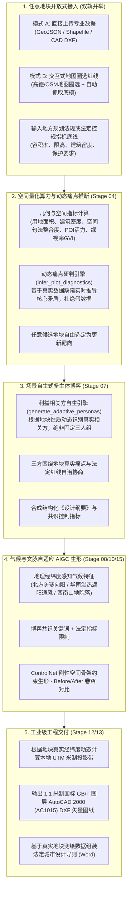

# 零预置模板 · 纯数据与算法驱动的通用因地制宜城市更新推演平台架构规范 (Design Spec)

## 一、 核心设计哲学：零预置、纯数据驱动、随地块而变

### 1.1 核心痛点与原则确立
- **彻底废除“预置案例模板库”**：真实世界中的城市更新绝无两块完全相同的土地。平台严禁预置静态示范工程、严禁提供固定风格选择下拉框。
- **全要素因地制宜**：任何城市、任何区位、任何类型的地块，系统必须基于**真实地理坐标、真实空间底模、真实量化指标与现场法定控规**，通过空间算法与大模型实时推演一切。

---

## 二、 总体架构与端到端工作流

---

## 三、 五大核心模块自适应实现规范

### 1. 任意地块开放式接入（双轨并举）
- **模式 A（专业数据上传）**：
  - 用户上传 `GeoJSON / Shapefile / DXF` 文件，系统自动解析图层（红线、现状建筑、道路拓扑、候选地块）。
  - 自动识别坐标系统（经纬度 WGS84、CGCS2000、UTM），自动提取空间边界。
- **模式 B（轻量圈选与自动抓取）**：
  - 用户输入城市名称，在交互式地图（MapLibre / Leaflet）上手动绘制多边形红线；
  - 自动调用后台内置的 `osm_fetcher` 与空间分析引擎，自动从 OpenStreetMap 拉取所圈选范围内的建筑轮廓与路网拓扑，自动合成现状底模。
- **法定红线约束输入**：
  - 用户输入当地控规刚性指标（如限高 $H \le 24\text{m}$，容积率 $\text{FAR} \le 2.0$，建筑密度 $\le 35\%$，绿地率 $\ge 25\%$，历史保护要素）。

---

### 2. 空间量化算力与动态痛点推断 (`infer_plot_diagnostics`)
系统根据地块真实特征动态推断痛点，彻底移除所有静态字符串：
- **用地类型为工业/仓储/棕地** ➔ 自动推断：“原产业物流功能外迁导致厂房闲置低效、大跨度工业结构待活化利用、工业风貌与城市界面割裂”；
- **用地类型为老旧居住组团** ➔ 自动推断：“公共服务与适老设施匮乏、微循环管网老化、人车混行严重、缺乏开敞活动绿地”；
- **用地类型为低效商业/集贸** ➔ 自动推断：“沿街占道经营混乱、空间环境品质衰退、停车与物流装卸阻碍交通”；
- **绿视率 GVI < 0.15** ➔ 自动推断：“绿地服务半径盲区，绿视率严重不足，需见缝插针织补口袋公园与微生态廊道”；
- **POI 密度过低** ➔ 自动推断：“功能单一，夜间经济与社区活力缺失”。
- **自由靶向锁定**：用户可点击任意候选地块，系统一键将其作为靶向更新地块，数据自动注入数据总线。

---

### 3. 场景自生式多主体博弈 (`generate_adaptive_personas`)
彻底废除固定的“居民老王、开发商赵总、规划师李工”，由大模型根据**地块性质与周边城市关系**现场衍生真实利益主体：
- **工业地块** ➔ 【厂区老职工/产业工人代表】、【棕地活化与文创投资机构】、【生态环保与工业遗存保护监管局】；
- **老旧居住组团** ➔ 【银发老龄与青年租户居民代表】、【物业与社区商业运营机构】、【街道办与民政老旧小区改造专班】；
- **历史文化街区** ➔ 【本土原住民代表】、【文旅资产运营方】、【历史名城保护与规划监督部门】；
- **滨水生态廊道** ➔ 【市民户外运动社群】、【水岸滨水商业运营商】、【水务与生态园林局】。
- 各方的诉求、谈判底线与核心冲突，完全基于地块真实数据动态生成，并围绕法定控规展开自治博弈，合成结构化《设计纲要》。

---

### 4. 气候与文脉自适应 AIGC 生形 (`generate_adaptive_prompts`)
彻底废除固定风格下拉框，AIGC 提示词由系统多模态动态转译：
- **地理气候自适应**：系统通过经纬度感知气候特征：
  - 北方严寒气候 ➔ 自动注入：“坡屋顶防雪、向阳开敞广场、防风林带、红砖暖色基调”；
  - 华南湿热气候 ➔ 自动注入：“底层架空骑楼、深出挑遮阳檐口、立体通风冷巷、通透遮阴绿廊”；
  - 西南山地水系 ➔ 自动注入：“依山就势跌级退台、透水铺装、宜人慢享街巷”；
  - 江南水网地带 ➔ 自动注入：“亲水驳岸步道、通透水榭、精致石桥微景观”。
- **博弈共识转译**：将博弈协商达成的容积率、开敞空间、功能业态转化为正负向提示词；
- **ControlNet 刚性空间约束**：将地块真实红线与建筑底模转为线框图，杜绝空间幻觉。

---

### 5. 工业级工程交付（真实地理投影与法定图则）
- **全球自适应 UTM 投影**：系统动态计算地块中心经度：
  $$\text{utm\_zone} = \lfloor(\text{lon} + 180) / 6\rfloor + 1$$
  北半球自动投影至 `EPSG:32600 + utm_zone`，确保全国乃至全球任意城市均输出 1:1 米制 AutoCAD 2000 (AC1015) 矢量图纸，图层规范统一遵循国标 GB/T。
- **法定控制图则 Word 导出**：自动填充该地块的真实测绘面积、法定编号与多主体博弈敲定的精确指标表（容积率、建筑密度、绿地率、限高）。
